 

 

I'm pursuing an **M.S. in Computer Science at Florida Atlantic University**. I work across the full stack: mobile and web clients, Go and Python services, LLM-backed workflows, and the cloud infrastructure, CI/CD, and observability that keep them running after launch.

**Currently open to full-time roles** in AI engineering, cloud/platform engineering, and full-stack product development.

CHAPTER 01

### Selected work

**[GoTogether Trip Planner](https://github.com/vulkanCommand/gotogether)** · [App Store](https://apps.apple.com/us/app/gotogether-trip-planner/id6767730138)  
A group trip-planning app released on the App Store. Shared itineraries, invites, expenses, notifications, and trip memories, backed by authenticated Go APIs, PostgreSQL, and cloud media storage with a production release pipeline.  
React Native · Expo · Go · PostgreSQL · Firebase · Google Cloud

**[xCommand Cloud](https://github.com/vulkanCommand/xcommand-n8n-rental)**  
On-demand automation infrastructure. Provisions isolated n8n workspaces behind dedicated URLs in seconds, manages container lifecycle and capacity, monitors platform health, and reclaims expired resources automatically.  
Docker · Traefik · FastAPI · n8n · Prometheus

**[Env Guardian](https://github.com/vulkanCommand/env-guardian)**  
A Go CLI and VS Code workflow that validates environment configuration before deployment: detects code/config drift and potential secret leaks, supports encrypted env files, and emits CI-ready JSON. Distributed via Homebrew.  
Go · CLI · VS Code · CI · Security

**[RoomCast](https://github.com/vulkanCommand/RoomCast)**  
Private two-person watch rooms with direct screen and voice streaming. Firebase handles identity and signaling; WebRTC carries media peer to peer, with no stored video, chat, or recordings.  
React · TypeScript · WebRTC · Firebase

<b>More projects</b>

 

| Project | Description | Stack |
| --- | --- | --- |
| [RooflyticsAI](https://github.com/vulkanCommand/Rooflytics-AI) | Turns natural-language business questions into SQL-backed analysis | LLMs, PostgreSQL, AWS |
| [AI File Analyzer](https://github.com/vulkanCommand/AI-File-Analyzer) | Document upload with cloud-generated summaries | Python, Amazon Bedrock, Lambda |
| [AWS DevOps Portfolio](https://github.com/vulkanCommand/aws-devops-portfolio) | Infrastructure, CI/CD, and monitoring as one delivery lifecycle | AWS, GitHub Actions |
| [SnapFile](https://github.com/vulkanCommand/SnapFile) | Syncs local file changes to cloud-backed storage | AWS S3 |

CHAPTER 02

### Technical focus

| | |
| --- | --- |
| **Languages** | Go, TypeScript, Python, C#, SQL, Bash |
| **Applications** | React, React Native, Expo, FastAPI, ASP.NET Core |
| **AI** | OpenAI, Claude, Gemini, Amazon Bedrock, RAG, vector search |
| **Cloud** | Google Cloud (Cloud Run, Cloud SQL, Storage), AWS (Lambda, S3, API Gateway) |
| **Platform** | Docker, Traefik, PostgreSQL, Firebase, GitHub Actions, Prometheus, Grafana |

CHAPTER 03

### Recognition

- **DXC Champ Award** for software development and infrastructure automation
- **Academic Excellence** recognition, Florida Atlantic University (4.0 semester GPA)
- Student member of the **Free Software Foundation**

 

  

